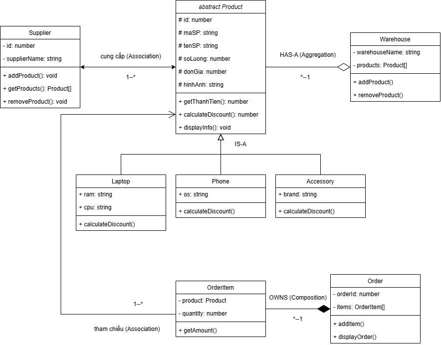

# PHẦN I. ĐỌC VÀ PHÂN TÍCH UML

## Câu 1

- a. Lớp trừu tượng: Product
- b. Các lớp kế thừa: Laptop, Phone, và Accessory
- c. Các thuộc tính của lớp Product: id, maSP, tenSP, soLuong, donGia, hinhAnh (all protected)
- d. Các phương thức của lớp Product: getThanhTien(), calculateDiscount(), displayInfo() (all public)

## Câu 2

- a.1 Quan hệ Association: Supplier <-> Product (quan hệ 2 chiều) (Supplier cung cấp sản phẩm, 2 bên là cùng cấp, không phụ thuộc lẫn nhau, và có thể tồn tại nếu bên kia bị xóa).
- a.2 Association: Product <-- OrderItem (quan hệ 1 chiều) (sản phẩm trong OrderItem tham chiếu đến Product)
- b. Quan hệ Aggregation: Warehouse o-- Product (Warehouse chứa (HAS-A) các Product nhưng khi Warehouse bị xóa thì các Product đó có thể được chuyển sang các kho khác và tồn tại ở đó chứ không bị xóa theo Warehouse chứa nó)
- c. Quan hệ Composition: OrderItem --\* Order (Order sở hữu (OWNS) các OrderItem và trạng thái của có, nếu như Order bị xóa thì các OrderItem và trạng thái của nó cũng bị xóa theo Order)
- d. Quan hệ Inheritance: Product <|-- Laptop, Phone, Accessory (Laptop, Phone, Accessory là 1 (IS-A) Product)
- e. Vẽ lại:

## Câu 10

- Đã thay đổi thiết kế của displayInfo(), và calculateDiscount() từ abstract sang không abstract nhưng 2 phương thức đó sử dụng 1 abstract property là: discount: number, và 1 protected property là: applyDis: boolean để thay đổi kết quả tùy theo Class thực hiện.
- Ví dụ ở Class Laptop: Before: discount: 15, applyDis: false -> calculateDiscount() [Product.ts] -> After: kết quả của calculcateDiscount(), và displayInfo() được đa hình vì kết hợp toán tử 3 ngôi và abstract properties
- Tóm lại: thay vì áp dụng abstract lên 2 methods đó thì tôi đã thêm 2 properties mà 2 methods đó sử dụng, áp dụng abstract lên property chỉ phần trăm discount. Từ đó đạt được kết quả mong muốn mà code ít bị copy/paste ở các Class hơn, chỉ cần gán giá trị cho property discount ở các Class khác thì 2 methods đó sẽ đa hình tùy theo Class vì "this.discount" abstract tùy theo class. Và vì tôi sử dụng for...of để duyệt products-bao gồm các instance object của các subclass khác nên mỗi vòng là 1 object khác nhau, 1 subclass khác nhau
