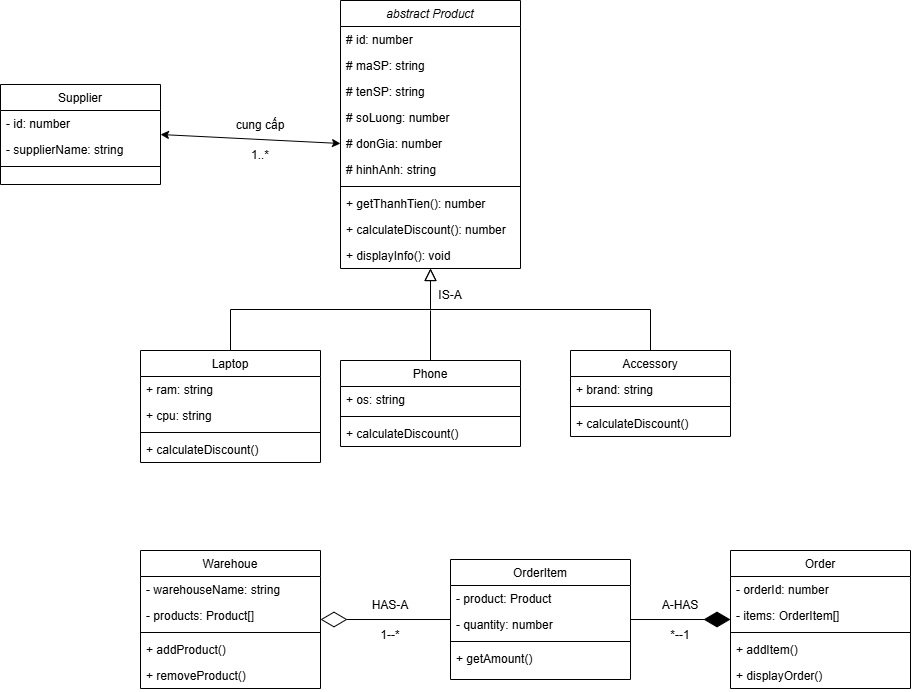

# PHẦN I. ĐỌC VÀ PHÂN TÍCH UML

## Câu 1

- a. Lớp trừu tượng: Product
- b. Các lớp kế thừa: Laptop, Phone, và Accessory
- c. Các thuộc tính của lớp Product: id, maSP, tenSP, soLuong, donGia, hinhAnh (all protected)
- d. Các phương thức của lớp Product: getThanhTien(), calculateDiscount(), displayInfo() (all public)

## Câu 2

- a. Quan hệ Association: Supplier <-> Product
- b. Quan hệ Aggregation: Warehouse o-- OrderItem
- c. Quan hệ Composition: OrderItem --\* Order
- d. Quan hệ Inheritance: Product <|-- Laptop, Phone, Accessory
- e. Vẽ lại:

